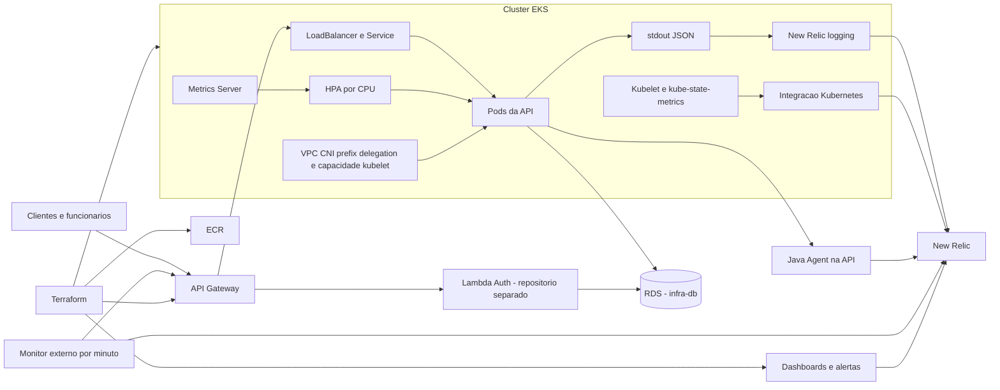

# oficina-dgcar-infra-k8s

Infraestrutura de execução e operação da Oficina DGCar em **homolog e prod**. Provisiona VPC, subnets, security groups, EKS, ECR, API Gateway, integrações New Relic, Metrics Server e suporte de capacidade para os pods. Mantém manifests Kubernetes e orquestra os repositórios de banco, Lambda e API.

O código da API, as migrations e o Terraform do RDS e da Lambda pertencem aos respectivos repositórios. A orquestração aciona esses componentes e integra suas dependências.

## Tecnologias e arquitetura

Terraform, AWS VPC/EKS/ECR/API Gateway, Kubernetes, Kustomize, Helm, VPC CNI, Metrics Server, New Relic, GitHub Actions, AWS CLI, GitHub CLI, Bash, Python e k6.



## Validação local

Pré-requisitos: Terraform (CI usa 1.15.8), kubectl, Python 3 e Bash para scripts shell; acesso aos registries para baixar providers. Na raiz:

```sh
terraform -chdir=terraform fmt -check -recursive
terraform -chdir=terraform init -backend=false
terraform -chdir=terraform validate
kubectl kustomize k8s > rendered-k8s.yaml
python3 -m unittest discover -s scripts/observability -p 'test_*.py'
python3 -m unittest discover -s scripts/hpa -p 'test_*.py'
bash -n scripts/preflight/*.sh scripts/github-actions/*.sh scripts/aws/*.sh scripts/smoke/*.sh
```

Esses comandos validam configuração e proteções; não provisionam a AWS. Um plano real exige backend, variáveis e credenciais do ambiente. A CI **Validar Infra K8s** roda em PRs e pushes de homolog/main e faz um plano sem refresh com observabilidade New Relic desabilitada. Esse plano não substitui consultas NerdGraph ou validação de telemetria.

## Provisionamento completo

O provisionamento completo é **manual por `workflow_dispatch`**, com `component=all` e confirmação. Na aba Actions:

| Ambiente | Workflow | Confirmação |
|---|---|---|
| homolog | Provisionar Ambiente Homolog | `confirm=PROVISIONAR` |
| prod | Provisionar Ambiente Prod | `confirm=PROVISIONAR_PROD` |

Selecione a referência correspondente ao ambiente. `run_smoke_tests` é opcional e tem padrão `false`; quando habilitado, exige as variáveis da massa de teste. A orquestração de homolog aciona os componentes na branch homolog; a de prod usa main. Aprovações dependem das regras configuradas nos GitHub Environments.

O fluxo valida credenciais, state e recursos residuais; provisiona rede, EKS, ECR, Gateway e componentes de observabilidade; publica dados de rede; aciona o banco e a Lambda; autoriza o security group da Lambda no RDS; publica o código da Lambda; integra `/auth/cpf`; publica a base do Gateway; aciona o deploy da API; integra o proxy e confere outputs. Os smoke tests executam somente quando solicitados.

### Atualização automática de ambientes existentes

Após merge, `homolog` atualiza homolog e `main` atualiza prod. API, Lambda e banco validam seus arquivos relevantes e solicitam a atualização do próprio componente ao coordenador. Mudanças de Terraform e dos scripts de coordenação neste repositório atualizam a plataforma existente, após a CI. README, Postman e documentação não disparam apply.

Os workflows centrais [homolog](.github/workflows/provision-homolog.yml) e [prod](.github/workflows/provision-prod.yml) recebem `component=api`, `database`, `lambda`, `lambda-code` ou `platform`, com `source_sha` completo. Esses modos atualizam um componente; `all` mantém o provisionamento completo manual. Para repetir uma atualização da plataforma, informe o SHA da própria branch. Para API/Lambda/banco, use a reexecução manual do workflow do componente, que encaminha o pedido à mesma fila.

Cada ambiente possui um grupo de concorrência compartilhado entre atualizações, provisionamento, destroy e manutenção. `queue: max` preserva até 100 pedidos pendentes, sem cancelar a execução em andamento; o limite e a ordem de espera seguem as [regras do GitHub Actions](https://docs.github.com/en/actions/how-tos/write-workflows/choose-when-workflows-run/control-workflow-concurrency). Os workers recebem `orchestrated=true`, `parent_run_id` e `source_sha`, verificam a execução pai e o histórico da branch antes de acessar a AWS e não geram novos pedidos. O coordenador aguarda o worker identificado pela execução pai.

Toda atualização Terraform executa `validate`, gera um plano salvo e verifica remoções/substituições antes de aplicar exatamente esse plano. Um plano bloqueado exige revisão e aprovação explícita; não há liberação automática de alterações destrutivas. A atualização de plataforma exige state e integrações existentes, preserva os endpoints do Gateway e não inicia o provisionamento completo se o ambiente estiver ausente. Os locks S3 permanecem ativos.

As decisões e os controles de promoção estão na [ADR-020](https://github.com/techdgconsulting/oficina-dgcar-docs/blob/homolog/docs/adr/ADR-020-promocao-e-deploy-automatico.md).

### Pré-requisitos por environment

Configure `AWS_ACCESS_KEY_ID`, `AWS_SECRET_ACCESS_KEY`, `AWS_REGION`, `GH_AUTOMATION_TOKEN`, `TF_STATE_BUCKET`, `TF_STATE_KEY`, `GH_ACTIONS_IAM_USER_ARN`, `GH_ACTIONS_IAM_USER_NAME`, `NEW_RELIC_LICENSE_KEY`, `NEW_RELIC_API_KEY` e `NEW_RELIC_ACCOUNT_ID` conforme a leitura de secrets/variables nos workflows.

O bucket de state e as permissões necessárias devem existir. Os environments dos repositórios dependentes também precisam de suas credenciais e configurações de runtime. Em particular, não há publicação automática de secrets de conexão do RDS no workflow atual de infra-db; confira `DB_*` na Lambda e `SPRING_DATASOURCE_*` na API antes de executar o fluxo completo.

Os smoke tests usam `CLIENT_TEST_CPF`, `CLIENT_TEST_PASSWORD`, `CLIENT_TEST_OS_NUMBER` e `CLIENT_OTHER_OS_NUMBER`. Não publique os valores em logs ou documentação.

## Atualização de dashboards e observabilidade

O Terraform instala `nri-bundle` no namespace `newrelic`, com infraestrutura, metadados, kube-state-metrics, eventos e logging. O coletor lê somente os arquivos dos containers da API e preserva o JSON, MDC, stacktrace e contexto do pod. O forwarding de logs do Java Agent fica desabilitado pelo workflow da API; o agente mantém APM e eventos de negócio.

Há dois dashboards por ambiente:

- `oficina-dgcar-<ambiente> - API e Kubernetes`: 14 widgets de pods Running/Ready, health, uptime, APM, recursos e limites reais por pod, restarts, falhas de OS e logs.
- `oficina-dgcar-<ambiente> - Negocio OS`: 7 widgets de estado, volume diário, tabela de OS, produtividade, duração e falhas.

Não há grid de HPA nem card de pods desejados. O monitor SIMPLE consulta readiness pelo API Gateway a cada minuto a partir de US_EAST_1, via GET, validando SSL e o texto de status UP e rejeitando redirecionamentos.

A política `oficina-dgcar-<ambiente> - Observabilidade` tem oito condições. O alerta externo também detecta perda de sinal após 180 segundos. As condições de notificação e pagamento não filtram por aplicação; não se deve afirmar isolamento completo por ambiente. O Terraform não define destinatários externos para os incidentes.

| Workflow de homolog | Uso |
|---|---|
| Atualizar Dashboard Operacional Homolog — `dashboard` | Atualiza somente o dashboard operacional; padrão dos pushes nos caminhos monitorados |
| Mesmo workflow — `deploy` | Aplica dashboard, coletor, monitor e condições operacionais permitidas; aguarda coleta e verifica telemetria |
| Mesmo workflow — `verify` | Valida plano, consultas e telemetria sem apply |
| Atualizar Dashboard Negocio Homolog — `business` | Aplica somente o dashboard de negócio, com proteção de escopo e validação das consultas quando há alteração |
| Mesmo workflow — `inspect` | Inspeciona telemetria em modo de leitura |

Os workflows específicos de dashboards são manuais e servem à manutenção e inspeção de homolog. O fluxo automático de Terraform pertence ao coordenador, evitando dois applies para a mesma alteração. `scope=inspect` mantém a inspeção sem apply.

Os validadores executam NRQL via NerdGraph antes do apply. A validação operacional ao vivo compara pods/limites com Kubernetes, verifica health externo e duas requisições a `/api-docs` pelo LoadBalancer, correlacionadas com logs e APM. `redeploy_api=true` na modalidade deploy pausa e restaura a API durante o upgrade Helm e causa indisponibilidade temporária.

Esses workflows e o script live estão direcionados a homolog. Prod utiliza o provisionamento correspondente e deve ser verificado com seus próprios recursos; sucesso em homolog não comprova ingestão em prod. Planos com `-target` limitam a manutenção e não verificam todas as diferenças do ambiente.

### Leitura dos indicadores e filtros

| Indicador | Interpretação |
|---|---|
| Pods ativos | Último estado Running e Ready por pod, com amostra nos últimos três minutos; não contabiliza pods antigos de rollouts pelo histórico do período. |
| Health externo | Último SUCCESS/FAILED do readiness pelo Gateway, em janela fixa de cinco minutos. Sem amostras significa ausência de telemetria. |
| Uptime | Percentual de `SyntheticCheck` com SUCCESS no período selecionado; não representa disponibilidade anterior à criação do monitor. |
| Latência e tráfego | p95 e média em milissegundos, throughput por minuto e erros HTTP por código. |
| CPU e memória | Consumo e limite real do container `oficina-api`, por pod; CPU em cores e memória em MiB. Ausência da linha de limite não significa limite zero. |
| Falhas de OS | Evento `FALHA_PROCESSAMENTO`, filtrado por `app_name` do ambiente. |
| Logs | Data/hora, nível, mensagem, método, rota, status HTTP, duração, `correlationId`, `trace.id` e pod. |

Filtros de pod, nível e `correlationId` aceitam `%` para todos. Pod filtra recursos e logs; os outros dois filtros se aplicam aos logs. O seletor de período controla histórico e uptime, sem alterar os cards de estado atual.

O coletor lê `/var/log/containers/oficina-api-*_oficina_oficina-api-*.log`. Para correlacionar operações, filtre os logs por `correlationId`; quando disponível, `trace.id` permite abrir o trace associado. O filtro HTTP não registra corpos nem headers de autorização. A coleta restrita à API evita ingerir logs de todo o cluster; retenção e volume dependem da conta New Relic.

### Publicação e conferência dos dashboards

1. Execute a CI da API quando houver mudanças na instrumentação e a CI da infraestrutura para alterações de configuração.
2. Use `Atualizar Dashboard Operacional Homolog`, fase `deploy`, para dashboard, coletor, monitor e alertas relacionados. O plano tem escopo protegido e valida as 14 consultas por NerdGraph antes do apply.
3. Confira pods ativos contra Kubernetes, limites contra `resources.limits`, sucesso do monitor e duas requisições com o mesmo `correlationId`, com seus registros JSON, traces distintos e transações APM. Verifique a ausência de logs duplicados.
4. Na migração dos dashboards antigos, use `retire` somente após a conferência passar. O plano permite apenas as duas exclusões previstas; os outputs antigos passam a apontar para o dashboard unificado.
5. Use `verify` para repetir a conferência sem apply. Mudanças somente de layout usam `dashboard`; mudanças no coletor exigem `deploy`.

Em homolog com um único nó sem vaga para o hook Helm, `deploy` com `redeploy_api=true` salva as réplicas, pausa a API, limpa hooks pendentes e restaura a aplicação mesmo se uma etapa falhar. A operação causa indisponibilidade temporária, sem alterar a quantidade de nós ou reiniciar pods de sistema.

O alerta externo considera duas janelas consecutivas de um minuto com falha e perda de sinal de três minutos. O tempo de abertura e recuperação inclui agregação e ingestão; não é uma garantia de notificação em dois minutos. Incidentes no New Relic não equivalem a envio externo de mensagens.

## HPA e capacidade

O HPA usa CPU alvo de 70% sobre request de 250m, mínimo 1 e máximo 3 réplicas. A API tem limit de CPU 500m e request/limit de memória 512Mi/768Mi. O Metrics Server fornece a métrica ao HPA; New Relic serve para observação.

O manifesto declara estabilização de subida de 60 s e descida de 300 s. O HPA gerado pelo workflow da API não declara `behavior`; confira o objeto aplicado antes de atribuir uma janela ao ambiente.

O suporte de capacidade habilita prefix delegation e instala um drop-in kubelet AL2023 com `maxPods=17` na EC2 existente. Esse teto inclui pods de sistema e não representa capacidade para 17 réplicas da API.

Em **Validar Escala HPA Homolog**, escolha `configure-and-test` para configurar o suporte e testar, ou `test-only` para usar o suporte existente. O ensaio k6 limita temporariamente o máximo a 2, comprova `1 → 2 Ready → 1` na mesma EC2 e restaura a configuração original. Três réplicas são o máximo configurado; duas são a capacidade demonstrada nesse ensaio de homolog.

O Runner funcional do Postman não substitui carga concorrente nem a confirmação de readiness pelo Kubernetes.

O ensaio do HPA é manual. Mudanças de infraestrutura seguem a atualização automática central; executar o teste de carga continua sendo uma operação explícita.

### Consulta e critérios do ensaio

Confira o contexto: `oficina-dgcar-homolog-eks` ou `oficina-dgcar-prod-eks`, conforme o ambiente consultado.

```sh
kubectl config current-context
kubectl get hpa oficina-api -n oficina -o yaml
kubectl describe hpa oficina-api -n oficina
kubectl get deployment oficina-api -n oficina -o yaml
kubectl get pods -n oficina -o wide
kubectl top pods -n oficina
kubectl get apiservice v1beta1.metrics.k8s.io
kubectl get nodes -o wide
```

O plano protegido restringe mudanças ao suporte do HPA; bloqueia alterações de EC2, node group, rede Terraform e dashboards. Em `test-only`, o plano também é gerado e validado, e o limite do HPA é alterado temporariamente para o ensaio.

O Job de capacidade escreve somente o drop-in `99-oficina-pod-capacity.conf` no kubelet AL2023, verifica suporte e restaura o arquivo anterior em caso de falha. Usa `hostNetwork`/`hostPID` e privilégio de manutenção, sem token Kubernetes. O ajuste persiste no disco do nó; a capacidade precisa ser conferida se a instância for substituída. Prefix delegation pode liberar um IP secundário dos pods da API previamente pausados, após confirmar que nenhum pod ativo o utiliza.

Os quatro containers dos agentes NRK8s usam requests de 25m/32Mi, preservando limites e coleta; o levantamento registrado em homolog mediu 12–21 MiB e menos de 10m por container. O Metrics Server usa uma réplica, requests de 25m/32Mi e limits de 200m/128Mi. O orçamento de CPU, memória e slots deve comportar o segundo pod junto aos workloads de sistema.

Critérios de aprovação:

1. Metrics Server disponível, `ScalingActive=True`, CPU numérica e exatamente uma réplica Ready antes da carga.
2. Preflight confirma capacidade para o segundo pod na mesma EC2.
3. `scripts/hpa/prove-scaling.py` salva a especificação em `hpa-original.json` e limita o HPA a mínimo 1/máximo 2, preservando alvo e comportamento efetivos.
4. k6 autentica uma vez e consulta `GET /api/ordens-servico` pelo LoadBalancer com rampa de 5, 10, 20 e 40 usuários simultâneos, sem criar ou alterar OS.
5. O HPA produz dois pods Ready e duas réplicas desejadas por três amostras consecutivas, com intervalo de 15 segundos. A espera pela subida é de até 600 segundos.
6. Após encerrar a carga, o teste aguarda até 660 segundos pelo retorno a uma réplica Ready e uma desejada. Os limites do ensaio não são garantias de tempo de resposta do HPA.
7. UID e provider ID do nó e localização dos pods comprovam a permanência na mesma EC2. Reinicialização da API, MemoryPressure ou taxa de erros HTTP igual ou superior a 1% reprovam o teste.
8. O script restaura a especificação original em `finally`; o workflow também restaura com `if: always()`. A verificação New Relic confere recursos, health externo e logs correlacionados.

Não há escala manual do Deployment durante a prova. A pausa/restauração da API na configuração do suporte ocorre antes da carga. O campo de réplicas desejadas é um critério do ensaio, não um widget do dashboard.

### Evidência e limites

A [execução 38794638490, de 15/10/2026](https://github.com/techdgconsulting/oficina-dgcar-infra-k8s/actions/runs/38794638490), concluiu em homolog a prova `1 → 2 Ready → 1`, a restauração e a validação New Relic. O artefato `hpa-scaling-evidence` contém `scaling.json`, `k6-summary.json` e `k6.log`, sem tokens ou conteúdo das OS.

Essa evidência não comprova três réplicas simultâneas, redundância entre nós ou resultado de carga em prod. A decisão e as limitações arquiteturais ficam na [ADR-015](https://github.com/techdgconsulting/oficina-dgcar-docs/blob/homolog/docs/adr/ADR-015-hpa-cluster-autoscaling.md).

## Outputs e integrações

| Grupo | Outputs Terraform |
|---|---|
| Rede | `vpc_id`, `public_subnet_ids`, `private_subnet_ids`, `eks_cluster_security_group_id` |
| Execução | `eks_cluster_name`, `eks_cluster_endpoint`, `ecr_repository_url` |
| Gateway | `api_gateway_id`, `api_gateway_endpoint`, `api_gateway_execution_arn` |
| Coleta | `new_relic_kubernetes_enabled`, `new_relic_kubernetes_namespace`, `new_relic_kubernetes_release` |
| Observabilidade | `new_relic_observability_enabled`, `new_relic_dashboard_operational_guid`, `new_relic_dashboard_business_guid`, `new_relic_alert_policy_id` |

`new_relic_dashboard_api_guid` e `new_relic_dashboard_kubernetes_guid` são aliases de compatibilidade para o mesmo dashboard operacional. Eles não indicam dashboards adicionais.

A orquestração publica valores de rede nos environments dependentes e o endpoint do Gateway como `OFICINA_PUBLIC_BASE_URL` na API. O deploy da API devolve `API_BACKEND_URL` para a integração proxy. Consulte [terraform/outputs.tf](terraform/outputs.tf) para a lista completa.

As integrações opcionais do Gateway usam `api_backend_url` para o proxy da API, `auth_lambda_invoke_arn` para a rota `POST /auth/cpf` e `auth_lambda_function_name` para a permissão de invocação. Os manifests em `k8s/` incluem namespace, ConfigMap, Deployment, Service, HPA e Kustomization. `secret.example.yaml` é apenas um modelo; os secrets reais são fornecidos pelo ambiente ou pipeline.

## Contratos, validação funcional e operação

- [Swagger local da API](http://localhost:8080/swagger-ui.html) e [OpenAPI local](http://localhost:8080/api-docs).
- Em homolog/prod, use o output `api_gateway_endpoint` como base para `/swagger-ui.html`, `/api-docs` e `/actuator/health/readiness`.
- [Collection Postman](https://github.com/techdgconsulting/oficina-dgcar-api/blob/homolog/postman/Oficina-DGCar-Tech-Challenge-Fase-3.postman_collection.json).
- [Contrato da Lambda Auth](https://github.com/techdgconsulting/oficina-dgcar-auth-lambda/blob/homolog/src/handler.js).
- [Documentação central](https://github.com/techdgconsulting/oficina-dgcar-docs): decisões arquiteturais, logs, métricas e definição dos dashboards.

O teardown tem workflows próprios `destroy-homolog.yml` e `destroy-prod.yml`, acionados por dispatch com confirmação. Ele não faz parte da validação local ou da atualização de dashboards. As proteções do RDS e as dependências entre recursos devem ser respeitadas pelo procedimento do ambiente.

## Verificação funcional e registro da operação

Depois do provisionamento, confira readiness pelo API Gateway e os pods da API. Valide `POST /auth/cpf` com um cliente de teste, o JWT CLIENTE e a consulta da OS por número; confira rejeição sem token, com token inválido e com OS de outro cliente. Os dados de smoke tests são necessários apenas quando `run_smoke_tests=true`.

Na observabilidade, confira os dois dashboards do ambiente, o monitor externo e a ingestão dos logs correlacionados. Antes de interpretar um widget vazio, verifique janela de consulta e chegada da telemetria.

Registre ambiente, referência de código, URL da execução e resultado das etapas. Inclua endpoint e readiness no provisionamento e recursos remanescentes na remoção. Preserve senhas, tokens e CPF completo fora das evidências. Os ensaios automatizados descritos para homolog não comprovam o estado de prod.

## Remoção do ambiente

| Ambiente | Workflow | Confirmação |
|---|---|---|
| homolog | Destruir Ambiente Homolog | `DESTRUIR` |
| prod | Destruir Ambiente Prod | `DESTRUIR_PROD` |

O formulário dos workflows centrais de provisionamento e remoção não possui input `environment`; o ambiente é definido pelo workflow selecionado. Confira também a referência de código antes do dispatch.

A orquestração valida identidade AWS, state e locks; remove workloads e Services LoadBalancer; retira integrações dependentes; aciona a remoção do RDS e da Lambda; aguarda ENIs e dependências da VPC; remove infraestrutura Kubernetes, Gateway, ECR, dashboards e rede; e verifica recursos remanescentes. A exclusão de recursos AWS criados pelo Kubernetes é assíncrona e pode exigir diagnóstico e nova tentativa.

### Compatibilidade entre repositórios

Os workflows de remoção despacham `action=destroy-infra` e `action=destroy` para os workers, na referência de recuperação `main`, com confirmação e identificação do coordenador. Não existe gatilho automático de destroy.

O banco utiliza `db.t3.micro`, `gp2` e retenção automática zero nos dois ambientes. Prod mantém proteção contra exclusão e snapshot final. A preparação de destroy remove a proteção de forma explícita e, em prod, usa um snapshot final único por execução. Consulte o [README de infra-db](https://github.com/techdgconsulting/oficina-dgcar-infra-db/blob/homolog/README.md).

### Tratamento de falhas operacionais

| Situação | Tratamento ou conferência |
|---|---|
| URI inválida no Gateway | Integrações dependentes são aplicadas após obter os endpoints reais da Lambda e da API. |
| Restrições Free Tier no RDS | Confira classe, storage e retenção definidos para o ambiente no repositório de banco. |
| Snapshot final ou deletion protection | Homolog usa remoção sem snapshot; prod exige verificar proteção e nome do snapshot na referência acionada. |
| Remoção da Lambda | Confira suporte a `destroy-infra`, empacotamento para refresh do state e liberação do security group na referência acionada. |
| Outputs ou secrets de integração ausentes | Confira a limpeza idempotente do workflow e os valores publicados pela orquestração. |
| Backend e região | O backend usa `use_lockfile=true`; confira a região configurada, com fallback operacional `us-east-1` nos workflows que o definem. |
| Acesso kubectl | Os workflows atualizam kubeconfig antes de operar o cluster. |
| Security groups residuais | Scripts tratam grupos sem ENI antes da remoção final da VPC. |
| Node group em `CREATE_FAILED` | O provisionamento trata o node group falho antes de tentar criar o ambiente novamente. |

As decisões de infraestrutura e de proteção do banco estão na [ADR-019](https://github.com/techdgconsulting/oficina-dgcar-docs/blob/homolog/docs/adr/ADR-019-infraestrutura-aws-terraform-kubernetes.md) e na [ADR-017](https://github.com/techdgconsulting/oficina-dgcar-docs/blob/homolog/docs/adr/ADR-017-postgresql-gerenciado.md).
